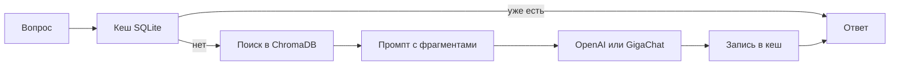

# RAG-ассистент

Консольный ассистент с поиском по документам (RAG). Одна и та же база знаний работает в двух вариантах: через OpenAI и через GigaChat.

Документы лежат в `data/docs.txt` внутри каждой папки. При первом запуске текст режется на фрагменты, для них считаются векторы и сохраняются в ChromaDB. Повторный такой же вопрос берётся из SQLite-кеша и повторно в модель не отправляется.

После клонирования репозитория ключей и готовой базы векторов в нём нет: их нужно создать локально, как описано ниже.

## Как проходит запрос



Обе папки устроены одинаково. Отличается только модель: в `assistant_api` это OpenAI, в `assistant_giga` — GigaChat.

## Состав

| Папка | Что делает |
|---|---|
| `assistant_api` | Ответы через OpenAI (`gpt-4o-mini`), эмбеддинги `text-embedding-3-small`, оценка качества через RAGAS |
| `assistant_giga` | Ответы через GigaChat |

В корне проекта:

| Файл | Назначение |
|---|---|
| `requirements.txt` | Список библиотек для `pip install` |
| `.env.example` | Шаблон ключей. Его можно коммитить |
| `.env` | Рабочие ключи. В GitHub не выкладывается |
| `.gitignore` | Исключает `.env`, `.venv`, `chroma_db` и `*.db` |

Команды в диалоге `app.py`: `stats` показывает статистику хранилища и кеша, `clear` очищает кеш, `exit` завершает программу.

## Требования

Python 3.11.

## Установка

Клонируйте репозиторий и перейдите в его папку. Дальше, в Windows:

```powershell
py -3.11 -m venv .venv
.\.venv\Scripts\activate
pip install -r requirements.txt
copy .env.example .env
```

В macOS и Linux:

```bash
python3.11 -m venv .venv
source .venv/bin/activate
pip install -r requirements.txt
cp .env.example .env
```

В `.env` подставьте свои ключи:

```
OPENAI_API_KEY=ключ OpenAI

GIGACHAT_AUTH_KEY=ключ авторизации GigaChat
GIGACHAT_RQUID=идентификатор запроса GigaChat
```

Ключ OpenAI создаётся в кабинете платформы: [platform.openai.com/api-keys](https://platform.openai.com/api-keys). Ключ авторизации GigaChat выдаётся в личном кабинете на [developers.sber.ru](https://developers.sber.ru/docs/ru/gigachat/individuals-quickstart). `GIGACHAT_RQUID` — любой идентификатор в формате UUID; его задаёте вы сами и записываете в `.env`. Проект передаёт его в каждом запросе за токеном.

Файл `.env` указан в `.gitignore`. Его нельзя коммитить: в истории GitHub ключ останется даже после удаления файла.

Дальше команды запускаются из папки `assistant_api` или `assistant_giga`, при активированном окружении. На Windows интерпретатор вызывается как `py`, на macOS и Linux — как `python`.

## Чего нет в репозитории

Эти файлы появляются на вашем компьютере при запуске и в GitHub не входят:

| Что появляется | Когда |
|---|---|
| `.env` | вы копируете его из `.env.example` и вписываете ключи |
| `.venv` | после создания виртуального окружения |
| `assistant_api/chroma_db`, `assistant_giga/chroma_db` | при первой загрузке документов |
| `*.db` рядом со скриптом | при первом ответе, который сохраняется в кеш |

База знаний, которая есть в репозитории, — это `assistant_api/data/docs.txt` и `assistant_giga/data/docs.txt`. Свой текст можно подставить в эти файлы до первого запуска. Если коллекция уже создана, новый текст подхватится только у пустой коллекции: старую папку `chroma_db` нужно удалить.

## Файлы OpenAI (`assistant_api`)

Запускать из папки `assistant_api`. Нужен `OPENAI_API_KEY`.

### `py app.py`

Основная программа. Открывает диалог: вы вводите вопрос, ассистент ищет фрагменты в ChromaDB и отвечает через `gpt-4o-mini`. Если коллекция пустая, при старте загружается `data/docs.txt`. Кеш пишется в `api_rag_cache.db`.

### `py rag_pipeline.py`

Проверка цепочки без диалога. Задаёт три фиксированных вопроса («Что такое машинное обучение?», «Что такое RAG?», «Как работают трансформеры?»), печатает ответы, затем повторяет первый вопрос и показывает, что он взят из кеша. В конце выводит статистику.

### `py vector_store.py`

Проверка только поиска, без генерации ответа. Создаёт коллекцию `test_collection`, загружает `data/docs.txt`, ищет «Что такое машинное обучение?» и печатает три ближайших фрагмента с расстоянием.

### `py cache.py`

Проверка кеша без сети и без ключей. Записывает один тестовый вопрос, читает его обратно, печатает статистику и удаляет временный файл `test_cache.db`.

### `py evaluate_ragas.py`

Оценка качества. Скрипт сам задаёт пять вопросов из `data/docs.txt`, получает ответы RAG (кеш при этом не используется) и считает три метрики RAGAS. Вызов OpenAI занимает несколько минут. В конце печатаются средние значения, балл по каждому вопросу и пояснение.

Пять вопросов:

1. Что такое машинное обучение?
2. Какие основные типы машинного обучения существуют?
3. Что такое нейронная сеть?
4. Как работают трансформеры в NLP?
5. Что такое RAG и как он работает?

`data/docs.txt` сам по себе не запускается. Это текст базы знаний: машинное обучение, нейросети, трансформеры, RAG, векторный поиск и смежные темы.

## Файлы GigaChat (`assistant_giga`)

Запускать из папки `assistant_giga`. Нужны `GIGACHAT_AUTH_KEY` и `GIGACHAT_RQUID`.

### `py app.py`

Тот же диалог, что и в OpenAI-версии, но ответы генерирует GigaChat. Коллекция называется `gigachat_rag_collection`, кеш — `gigachat_rag_cache.db`.

### `py rag_pipeline.py`

Та же автоматическая проверка трёх вопросов, повтор первого из кеша и статистика. Модель — GigaChat.

### `py vector_store.py`

Та же проверка поиска, что и в OpenAI-версии, но векторы запрашиваются у GigaChat.

### `py gigachat_client.py`

Проверка доступа к API без RAG. Получает токен, печатает список моделей, задаёт один короткий вопрос и запрашивает эмбеддинг тестовой строки.

### `py cache.py`

Та же локальная проверка SQLite, что и в `assistant_api`. Ключи не нужны.

Если эндпоинт эмбеддингов GigaChat отвечает `402 Payment Required`, поиск переключается на запасные хеш-векторы из `gigachat_client.py`. Ответы модели при этом продолжают приходить, но найденный контекст может быть слабее.

## Метрики RAGAS

Их считает только `assistant_api/evaluate_ragas.py`. Каждая метрика — число от 0 до 1. Чем ближе к 1, тем лучше. Итоговый балл в отчёте — среднее трёх метрик по всем вопросам.

Скрипт сам подписывает средний балл:

- от 0.7 — хорошее качество;
- от 0.5 до 0.7 — приемлемо, но документы или промпт стоит улучшить;
- ниже 0.5 — качество слабое, стоит пересмотреть нарезку текста или сами документы.

### Faithfulness

Показывает, опирается ли ответ на найденные фрагменты, а не на знания модели «со стороны».

RAGAS разбивает ответ на отдельные утверждения и для каждого спрашивает модель: следует ли это утверждение из переданного контекста. Оценка — доля подтверждённых утверждений. 1.0 значит, что всё сказанное есть в найденных документах. Низкое значение значит, что модель добавила факты, которых в контексте не было.

Эта метрика не проверяет, ответила ли модель именно на вопрос. Ответ может быть верным по смыслу вопроса и всё равно получить низкий Faithfulness, если факты взяты не из найденных фрагментов.

### Context Precision

Показывает, насколько удачно поиск отобрал фрагменты и поставил полезные выше бесполезных.

Для каждого найденного фрагмента модель решает, нужен ли он, чтобы ответить на вопрос. Затем считается средняя точность с учётом порядка: полезный фрагмент на первом месте поднимает оценку, полезный фрагмент внизу списка её снижает. 1.0 значит, что сверху оказались нужные куски текста. Низкое значение значит, что поиск принёс мало относящегося к вопросу или поставил его после лишнего.

В этом проекте эталоном для сравнения служит начало ответа самой системы, а не отдельно написанный правильный ответ. Поэтому метрика смотрит, согласуется ли найденный контекст с тем, что система уже ответила.

### Answer Relevancy

Показывает, отвечает ли текст именно на заданный вопрос, без ухода в сторону и без пустых формулировок.

Модель читает ответ и придумывает по нему несколько вопросов. Эти вопросы переводятся в векторы и сравниваются с вектором исходного вопроса. Оценка — средняя близость. 1.0 значит, что по ответу легко восстановить исходный вопрос: ответ про то, о чём спросили. Низкое значение значит, что ответ общий, про другую тему или уклончивый («не знаю», «нет информации») — такие ответы получают 0.

Answer Relevancy не проверяет фактическую верность. Уверенный, но выдуманный ответ может получить высокую релевантность и низкий Faithfulness.
